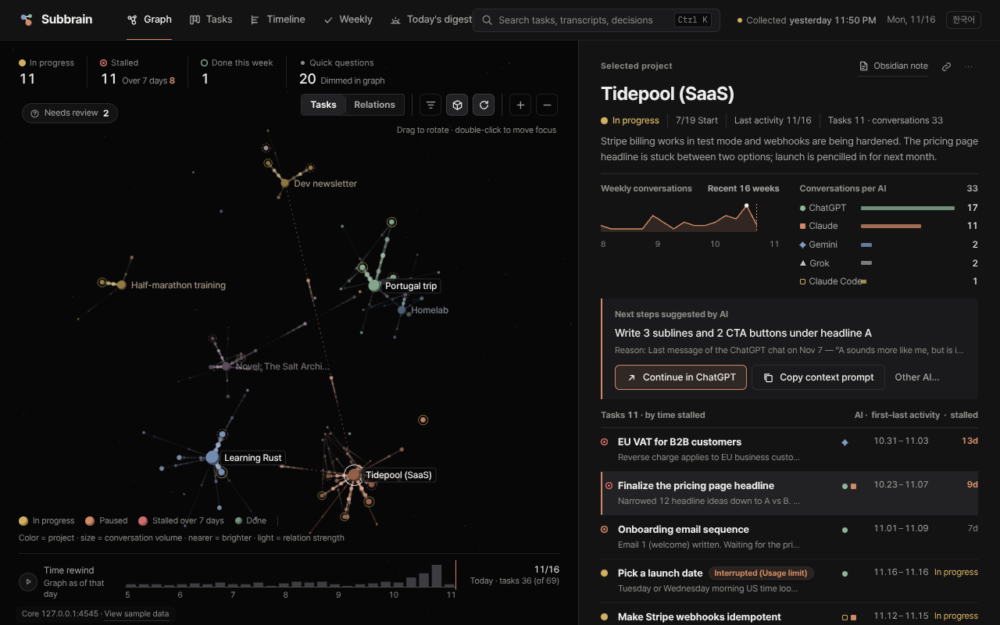
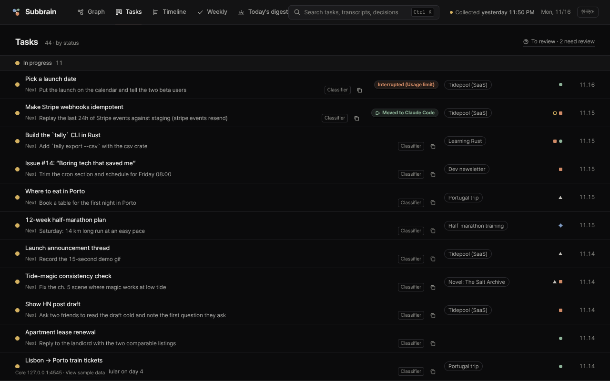
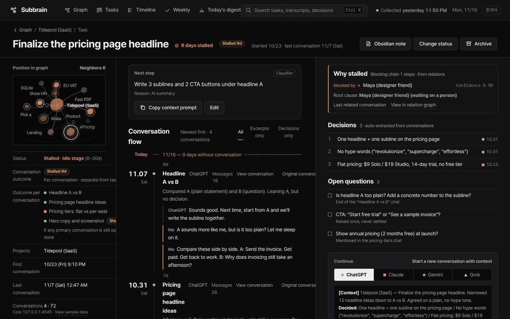
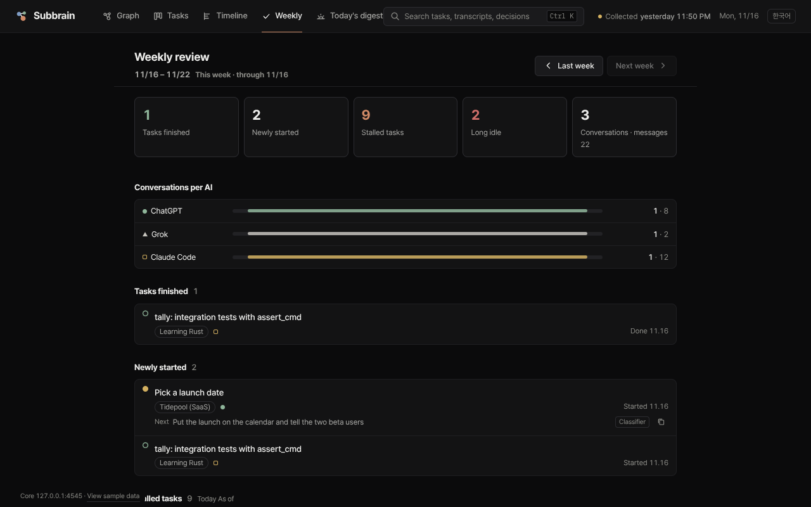
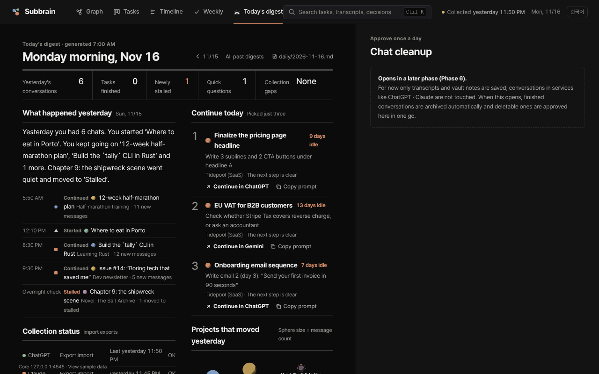

# Subbrain

**A local-first work memory for your AI chats.** Subbrain pulls in your ChatGPT, Claude, Gemini and Grok conversations (plus Claude Code / Codex sessions), figures out which ones are **done, in progress or stalled**, groups them into **projects and tasks with a next step**, and lets any AI agent pick up where you left off through a **layered MCP table of contents** — reading only as much as it needs.

> **Status: v0.1.0-alpha.** It works end to end on real data, but expect rough edges (see [Known limitations](#known-limitations)). Everything runs on your machine; nothing is uploaded except the (optional) LLM classification calls you configure.



<sub>Demo data: a fictional indie developer launching a SaaS, writing a novel, learning Rust and planning a trip — across ChatGPT, Claude, Gemini, Grok and Claude Code.</sub>

## Why another "AI memory" tool?

Most tools either archive chats (search them later) or give an agent a memory store. Subbrain sits in between: it treats your chats as **work** and tells you what state that work is in.

| | Subbrain | [kept](https://github.com/egroup-labs/kept) | [basic-memory](https://github.com/basicmachines-co/basic-memory) | [mem0](https://github.com/mem0ai/mem0) |
|---|---|---|---|---|
| Import ChatGPT / Claude / Gemini / Grok chats | ✅ | ✅ | — | — |
| **Status per chat: done / in progress / stalled / moved elsewhere** | ✅ | — | — | — |
| **Projects → tasks with an AI-suggested next step** | ✅ | — | — | — |
| **Weekly review** (done, started, stalled, long-idle) — rule-based, no LLM cost | ✅ | — | — | — |
| **Archive-only cleanup** of finished chats in the source services (never deletes) | ✅ | — | — | — |
| **Layered TOC over MCP** (index → project → task → excerpt) to keep agent context small | ✅ | flat MCP search | — | — |
| **Shared, editable Markdown memory with git history & revert** | ✅ | — | ✅ | — |
| Local-first, SQLite single source of truth, Obsidian vault export | ✅ | ✅ | ✅ | — |

### What's unique

- **Status classification of chats.** Each conversation gets a status (*done · in progress · stalled · quick question*) and an outcome (*done · moved to another tool · interrupted · open*). "Let's continue tomorrow" is not done; "summarize this, I'll continue in Claude Code" is a hand-off, not an abandoned chat.
- **Project / task grouping with next steps.** Conversations about the same goal are merged into a task; tasks roll up into projects; each task carries a one-line next step (AI-suggested or written by you — your edits are never overwritten).
- **Weekly review.** What you finished, started, left stalled and forgot about — computed with rules, zero LLM calls.
- **Archive-only cleanup.** Finished chats are exported once more and queued for archiving in the source service. Subbrain never deletes and never drives your browser; for ChatGPT you click Archive yourself, for services without archive it is only marked as tidied inside Subbrain.
- **Layered TOC for agents (MCP).** `toc_index` → `toc_project` → `toc_task` → `toc_conversation_excerpt`. An agent reads the 2 KB index first and only drills into what matters, instead of loading your whole history. Sensitive projects (🔒) are excluded and person names are masked.
- **Shared editable memory.** `tools/memory/` mirrors the TOC into a plain Markdown folder under local git. Any bot can read it, append to its own "my notes" block, and every change can be reverted (`memory-revert.sh`). Notes and next-step edits sync back to Subbrain.

## Quick start

Requires **Node 22.13+** (uses the built-in `node:sqlite` with FTS5) and git. pnpm is used via corepack.

```bash
git clone https://github.com/<your-account>/subbrain.git
cd subbrain
npm run setup      # installs deps, builds the web app, creates fake demo data, optionally asks for a Gemini key
npm run demo       # → http://127.0.0.1:4545  (fictional sample data, no key, no network)
npm run demo -- --lang ko   # the Korean demo dataset and Korean texts
```

> Use `npm run setup` (or `pnpm run setup`) — plain `pnpm setup` is a built-in pnpm command.

When you're ready for your own data:

```bash
npm run import -- ~/Downloads/chatgpt-export.zip     # ChatGPT: Settings → Data controls → Export data
npm run import -- ~/Downloads/claude-export.zip      # Claude: Settings → Privacy → Export data
npm run import -- ~/Downloads/takeout.zip            # Gemini: takeout.google.com → My Activity → Gemini Apps
npm run app                                          # → http://127.0.0.1:4545, data in ~/.subbrain
```

- **No API key?** Everything works with the built-in rule classifier (free, offline). Add `--no-classify` to import without classifying at all.
- **Gemini key** (optional, recommended): entered during `npm run setup` or in Settings. Stored only in `~/.subbrain/secrets.json` (mode 600). Other providers: `ANTHROPIC_API_KEY`, `OPENAI_API_KEY`, `XAI_API_KEY`, or a local Ollama model. A daily cost cap (`llm.dailyCostCapUsd`, default $10) defers anything beyond it.
- Secrets in chats (API keys, emails, phone numbers, card numbers…) are masked before anything is sent to an LLM; sensitive projects and keywords are never sent.

### Language

- English by default. `--lang ko` (or `SUBBRAIN_LANG=ko`) switches the demo dataset, server-generated text (morning digest, next-step reasons, stalled labels, rule-classifier summaries, TOC/MCP text, terminal messages) and the classification prompt to Korean: `npm run demo -- --lang ko`, `npm run app -- --lang ko`.
- UI only: add `?lang=ko` to the URL or use the 한국어 / EN button in the top bar. (The UI and server languages are set separately, so mixing them gives mixed text.)
- The English demo re-seeds on every `npm run demo` so its dates stay relative to today; add `--keep` to reuse the existing `.demo/` data.

### Connect an AI agent (MCP)

```bash
cd packages/core && npx tsx src/cli.ts mcp            # STDIO MCP server, read-only by default
```

See [docs/mcp-guide.md](docs/mcp-guide.md) and [docs/toc-guide.md](docs/toc-guide.md) (Korean for now). Write tools (`toc_update_task`, undo) are only registered with `--write`, and every write can be reverted from the "Written by AI" list.

### Shared memory folder

```bash
node scripts/toc-export.mjs --out /tmp/snap                 # snapshot the TOC from a running core
MEMORY_DIR=~/subbrain-memory bash tools/memory/memory-regen.sh /tmp/snap/toc-latest.tgz
bash tools/memory/memory-log.sh                              # history
bash tools/memory/memory-revert.sh <commit>                  # undo a change (as a new commit)
```

## How it works

```
packages/shared   API types, zod schemas, constants, mock JSON (generated from the engine)
packages/core     local engine: Hono HTTP API on 127.0.0.1, SQLite (node:sqlite, FTS5), importers,
                  classifier (LLM via AI SDK or rules), rule engine, Obsidian vault writer, digest,
                  weekly review, cleanup, ontology, MCP server, layered TOC
web               React + Vite UI (Graphite dark design, Pretendard). Mock mode runs without a core.
extension         Chrome MV3 extension that captures chats from chatgpt.com / claude.ai (optional)
scripts           setup / run / import helpers, TOC export, memory write-back, API contract generator
tools/memory      shared Markdown memory folder (local git, revertable)
```

- SQLite is the single source of truth; the Obsidian vault is written one way (your edits there are backed up, not lost).
- The API contract is in [API_CONTRACT.md](API_CONTRACT.md) (generated; Korean).
- Developer notes: [docs/dev-guide_ko.md](docs/dev-guide_ko.md) (Korean).

## Development

```bash
pnpm install
pnpm test          # core tests (vitest)
pnpm --filter @subbrain/extension test
pnpm typecheck     # shared · core · web · extension
pnpm --filter @subbrain/web dev        # UI in mock mode, no core needed (http://127.0.0.1:5173)
pnpm dev                               # core in watch mode on the dev data folder (.data/)
```

## Known limitations

- **Alpha.** APIs and the database schema may still change between versions (migrations are automatic, back up `~/.subbrain` anyway).
- **Some Korean internals remain.** UI, demo data, digest, next steps, TOC/MCP text and CLI messages are English by default. Still Korean-only: the generated Obsidian vault notes, most non-TOC MCP tool descriptions, the ontology extraction prompt, rarely-seen API error messages, docs under `docs/`, the API contract, code comments, and the stored status values (`진행 중`, `멈춤` …) that the UI translates for display. The rule classifier still detects "continue later" phrases best in Korean.
- Times and day boundaries use your system time zone (fixed at startup; override with `SUBBRAIN_UTC_OFFSET=+02:00`). Restart the core after a DST change.
- The rule classifier (no key) is much less accurate than an LLM.
- Chat cleanup only marks / queues archiving; the deletion executor is intentionally off.
- The Chrome extension depends on the ChatGPT / Claude page structure and may break when they change.
- Tested on macOS and Linux. Windows is untested.
- Timeline and time-rewind views are placeholders.

## Roadmap

- Configurable time zone; English vault notes and MCP tool descriptions
- Packaged desktop app / single binary, auto-start
- Automatic skill extraction from finished tasks (opt-in, with cost estimate first)
- Post-task tidy step that updates the memory folder automatically
- More importers (Perplexity, Copilot, Cursor chats)

## Screenshots

| | |
|---|---|
|  |  |
|  |  |
|  | |

All from `npm run demo` (fictional data, 1280×800). Shot list for the rest (cleanup, MCP, memory folder, demo video): [docs/SCREENSHOTS.md](docs/SCREENSHOTS.md).

## Contributing

See [CONTRIBUTING.md](CONTRIBUTING.md). Bug reports with an anonymized export sample are the most helpful thing right now.

## License

[MIT](LICENSE) © Subbrain Contributors
